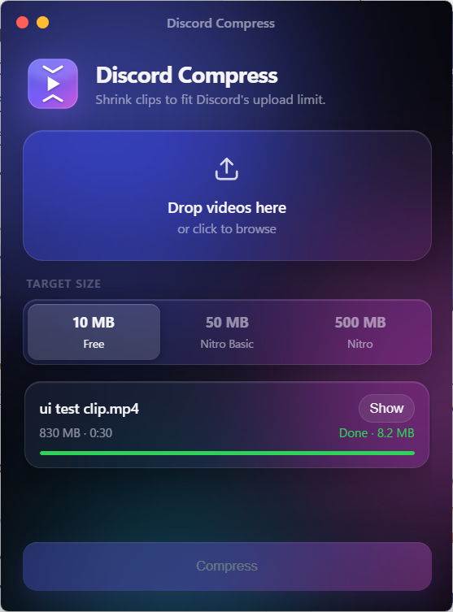

<p align="center"></p>

<h1 align="center">Discord Compress</h1>

<p align="center">Shrinks videos so they fit under Discord's upload limit. No setup, FFmpeg is built in.</p>

<p align="center"></p>

## Download

Get `DiscordCompress.exe` from the [latest release](../../releases/latest). Windows 10/11.

## Use

1. Open `DiscordCompress.exe` and drop videos on the window (or click to browse). You can also drag videos straight onto the exe.
2. Pick the target size: **10 MB** (free), **50 MB** (Nitro Basic) or **500 MB** (Nitro).
3. Hit **Compress**. Each file gets saved next to the original as `<name>_discord.mp4`. Click **Show** to open its folder.

## How it works

It works out the bitrate that fits the target size for the clip's length, then does a two-pass H.264 encode. Long clips are scaled down (1080p → 720p → 480p → 360p, by the short side so vertical clips stay sharp) and capped at 30 fps, because fewer pixels at a decent bitrate look better than blocky full HD.

## "Windows protected your PC"

The exe isn't code-signed, so SmartScreen may warn the first time. Click **More info → Run anyway**. The first launch can take a few seconds while it unpacks.

## Build it yourself

```
pip install pywebview pyinstaller pillow
python make_icon.py
pyinstaller --onefile --windowed --name DiscordCompress --icon icon.ico --add-binary "path\to\ffmpeg.exe;." --add-data "ui;ui" --add-data "icon.ico;." discord_compress.py
```

## License

GPL-3.0. The bundled `ffmpeg.exe` is an FFmpeg GPL build from [gyan.dev](https://www.gyan.dev/ffmpeg/builds/), with source at [ffmpeg.org](https://ffmpeg.org/download.html).
